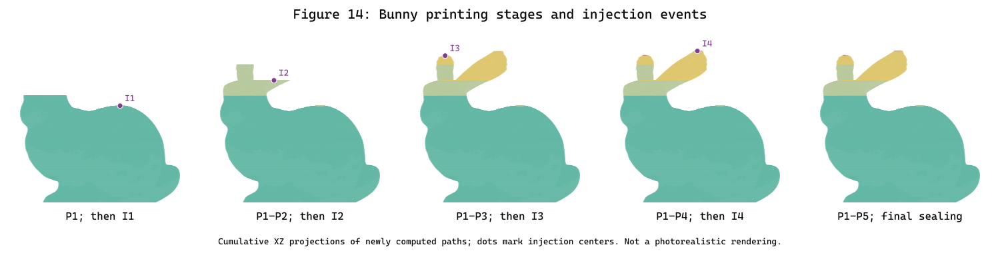

# InFuse

InFuse is a computational fabrication framework for in-situ 3D printing and material injection. It plans interleaved printing and injection operations under printing, injection, air-evacuation, and nozzle-accessibility constraints.

This repository contains the C++ command-line implementation, Windows build instructions, and a reproducible single-cavity Bunny example. The implementation builds on and extends the [ACAP framework](https://github.com/fanchao98/acap) with injection-aware sequence planning and fabrication processing. Upstream attribution is listed in [THIRD_PARTY_NOTICES.md](THIRD_PARTY_NOTICES.md).

**Paper:** [InFuse: Sequence Planning for In-Situ Printing and Material Injection](https://ieeexplore.ieee.org/document/11735140), *IEEE Transactions on Visualization and Computer Graphics*, 2026, pp. 1-18. [DOI: 10.1109/TVCG.2026.3743432](https://doi.org/10.1109/TVCG.2026.3743432).

## Installation

The supported platform is **Windows 11 x64**. [INSTALL_WINDOWS.txt](INSTALL_WINDOWS.txt) documents Visual Studio 2022, Python, CMake, and OpenCV installation, including a complete setup using fixed absolute paths.

With the source at `C:\InFuse` and the build tools installed as documented:

```powershell
powershell.exe -NoProfile -ExecutionPolicy Bypass -File C:\InFuse\scripts\build_windows.ps1
```

The script downloads and verifies OpenCV 4.4.0, builds InFuse, and runs the tests. Clipper 6.4.2 is included as source. No third-party Python packages are required. CGAL, Boost, Eigen, libigl, GMP, and MPFR are not build dependencies of this command-line implementation.

The executable is `C:\InFuse\build\Release\infuse.exe`; the generated Visual Studio solution is `C:\InFuse\build\InFuse.sln`. OpenCV runtime files, configuration, and G-code templates are copied beside the executable. Existing tool installations can be selected using the build script options documented in [INSTALL_WINDOWS.txt](INSTALL_WINDOWS.txt).

## Reproduce a paper result: Figure 14 (Bunny)

**Target:** the **Bunny row of Figure 14, "Gallery of results generated using InFuse"**, on **page 11 of the final manuscript** of [InFuse: Sequence Planning for In-Situ Printing and Material Injection](https://ieeexplore.ieee.org/document/11735140), DOI [10.1109/TVCG.2026.3743432](https://doi.org/10.1109/TVCG.2026.3743432). All figure references in this workflow use the final manuscript's numbering.

The reproducible part is the Bunny printing-stage geometry and injection-event data: **P1, I1, P2, I2, P3, I3, P4, I4, P5**. The script executes the planner and exports five incremental OBJ meshes and four injection centers, together with a cumulative-stage SVG preview. It does not copy the paper image or use precomputed meshes instead of running the algorithm. No printer or GPU is required.

### 1. Install and build

Place the repository at `C:\InFuse` and follow [INSTALL_WINDOWS.txt](INSTALL_WINDOWS.txt) to install the documented build tools. Then run:

```powershell
powershell.exe -NoProfile -ExecutionPolicy Bypass -File C:\InFuse\scripts\build_windows.ps1
```

### 2. Run the figure-data script without parameters

```powershell
powershell.exe -NoProfile -ExecutionPolicy Bypass -File C:\InFuse\reproduce.ps1
```

No model selection, command-line parameters, interactive interface, manual path edits, or external dataset download is needed. The fixed input is `C:\InFuse\examples\models\bunny_outer.stl`, processed in single-cavity `shell` mode using `C:\InFuse\config.ini`. The target and inputs are recorded in [reproducibility/experiment.json](reproducibility/experiment.json). Input properties and checksum are in [examples/models/README.md](examples/models/README.md).

Allow approximately **5-10 minutes** on the documented desktop; slower machines may take longer. The example produces approximately 360 MB of OBJ meshes plus paths and G-code. Each run creates a new `C:\InFuse\results\reproduction\TIMESTAMP` directory. A failed computation or comparison returns a nonzero exit code; a successful run prints the result directory and `Reference check: passed`.

### 3. Inspect the generated paper-result data

After the command succeeds, open the newly generated stage preview and inspect the stage mapping:

```powershell
$infuseRun = Join-Path C:\InFuse (Get-Content -LiteralPath C:\InFuse\results\reproduction\latest_run.txt -Raw).Trim()
Invoke-Item (Join-Path $infuseRun 'paper_figure.svg')
Get-Content -LiteralPath (Join-Path $infuseRun 'paper_stages.csv')
Get-Content -LiteralPath (Join-Path $infuseRun 'injection_events.csv')
Get-Content -LiteralPath (Join-Path $infuseRun 'paper_result.json')
```

The following paths are relative to that new result directory:

| Paper result | Generated data |
| --- | --- |
| P1, before I1 | `shell/bunny_outer/patches/patch_0.obj` |
| P2, between I1 and I2 | `shell/bunny_outer/patches/patch_1.obj` |
| P3, between I2 and I3 | `shell/bunny_outer/patches/patch_2.obj` |
| P4, between I3 and I4 | `shell/bunny_outer/patches/patch_3.obj` |
| P5, final printing/sealing | `shell/bunny_outer/patches/patch_4.obj` |
| I1-I4 | `injection_events.csv`, ordered by execution, with XYZ positions in millimeters |
| Left-to-right stage sequence | `paper_figure.svg`, generated from the new paths, and `paper_stages.csv` |

The OBJ meshes are **incremental printing stages**. To view the state after P3 in an OBJ-compatible viewer, load `patch_0.obj`, `patch_1.obj`, and `patch_2.obj` together in the same scene, without individually recentering them. In general, the state after Pk is the union of `patch_0.obj` through `patch_(k-1).obj`; `paper_stages.csv` lists these cumulative mesh sets explicitly. Injection coordinates use the same printing-platform frame as the OBJ meshes, rather than the original STL frame.

**Checks:** the Bunny result must contain five printing stages and four injection events, matching the labeled sequence in Figure 14. `paper_result.json` records this count check. `run_manifest.json` separately records `reference_check: passed`, input/configuration/binary hashes, the commands, environment, and timing. The numerical regression check compares the new output with [expected_metrics.json](reproducibility/expected_metrics.json); it is not an independent verification of every shape boundary in the paper image.

Reference preview from the complete verification run on 2026-10-25 (the command above regenerates its SVG from new computation):



The recorded [stage mapping](reproducibility/reference_bunny/paper_stages.csv) and [injection coordinates](reproducibility/reference_bunny/injection_events.csv) are supplied for inspection. They are reference outputs, not inputs to the planner. The fresh run must generate its own meshes and CSV files.

### Scope and file formats

This target is the **Bunny part only** of the gallery. OBJ meshes and the injection CSV provide the geometric/stage data for inspecting the illustrated sequence; the script need not recreate the paper's lighting, camera, nozzle illustrations, injected-material rendering, or raster pixels. `paper_figure.svg` is a cumulative **XZ projection**, not a photorealistic 3D rendering. Other gallery models, physical fabrication, and the paper's benchmark Tables I and II are outside this workflow.

The shipped example uses beam width 500 in `opp/helpers.h`; Section VI-A of the final manuscript reports 7500 for its benchmark configuration. Accordingly, no claim is made that this package reproduces the exact search statistics, travel distances, or runtimes in those tables. The figure-data workflow retains the bundled geometry and current algorithm settings rather than silently tuning them to force agreement.

OBJ, CSV, JSON, and SVG are standard formats. The custom nested path files and all new figure-output fields are documented in the plain-text [PAPER_RESULT.txt](reproducibility/PAPER_RESULT.txt) and [OUTPUT_FORMATS.md](reproducibility/OUTPUT_FORMATS.md). The latter also defines regression metrics, which are not physical fabrication-time estimates. The [reference table](reproducibility/reference_bunny/table.csv), [path projection](reproducibility/reference_bunny/toolpaths.svg), and [validation record](reproducibility/VALIDATION.md) provide supporting diagnostics. The small cylinder in `examples/demo.stl` remains a separate smoke-test input, not the paper-result target.

## Command-line usage

```powershell
& C:\InFuse\build\Release\infuse.exe --input C:\InFuse\examples\models\bunny_outer.stl --output C:\InFuse\results\bunny --mode shell
& C:\InFuse\build\Release\infuse.exe --input C:\InFuse\examples\demo.stl --output C:\InFuse\results\fusion --mode fusion
& C:\InFuse\build\Release\infuse.exe --input C:\InFuse\input_models --output C:\InFuse\results\batch --mode shell
```

Input must be **ASCII STL**, with coordinates in millimeters. Folder input processes direct children in sorted order and accepts `.stl` and `.STL`. Existing per-model output directories are rejected to prevent stale data from contaminating results; repeated runs require a new output location.

| Option | Description |
| --- | --- |
| `--input` | Required ASCII STL file or directory |
| `--output` | Output root; defaults to `results` |
| `--mode shell` | Single-cavity shell pipeline; default mode |
| `--mode fusion` | Outer/inner slicing and fusion pipeline |
| `--config` | Configuration file; defaults to `config.ini` in the current or executable directory |
| `--templates` | G-code template directory; defaults to `slice` in the current or executable directory |
| `--help` | Usage information |

Each model produces `Blocks_files`, `patches`, and `work` directories. The process returns zero only when all requested models succeed.

## Testing and limitations

The included tests cover both pipelines, single/batch numerical equivalence, output isolation, invalid inputs, source consistency, and example-model integrity. A GitHub Actions workflow automates Windows builds, tests, and the Bunny example.

The dependency graph has a 10,000-node capacity. Large or non-manifold models may violate algorithmic assumptions. Layer spacing is 0.2 mm and extrusion width is 0.4 mm in `opp/helpers.h`; `config.ini` must remain consistent. Nozzle geometry is defined in `opp/infuse_main.cpp`; mixing ratio, gap optimization, merging strength, and beam width are defined in `opp/helpers.h`.

Software execution requires no printer or GPU and does not perform physical motion. G-code startup/shutdown templates and injection calibration are machine-specific and must be adapted before physical fabrication. Linux and macOS support has not been validated. The command-line package does not include the interactive interface or hardware-control software.

## Citation

If you use the code for your research, please cite the paper:

```bibtex
@article{xu2026infuse,
  title   = {{InFuse}: Sequence Planning for In-Situ Printing and Material Injection},
  author  = {Xu, Hao and Feng, Shuai and Xiong, Yi and Zeng, Qiong and Li, Manyi and He, Liang and Xu, Wenpeng and Zhao, Haisen},
  journal = {IEEE Transactions on Visualization and Computer Graphics},
  year    = {2026},
  pages   = {1--18},
  doi     = {10.1109/TVCG.2026.3743432},
  url     = {https://ieeexplore.ieee.org/document/11735140}
}
```


## Third-party terms

Third-party components retain their respective notices and terms; see [THIRD_PARTY_NOTICES.md](THIRD_PARTY_NOTICES.md). This repository does not grant an additional project-wide license.
